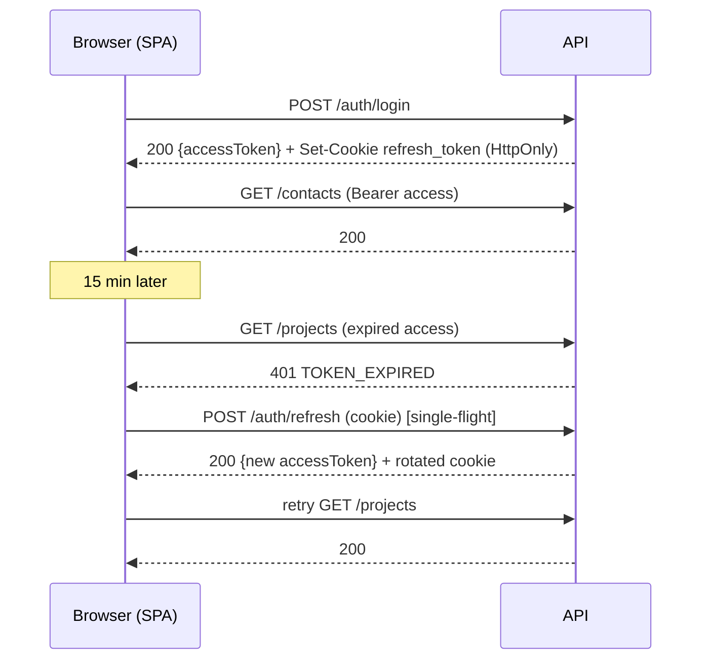

# Authentication Flows

All endpoints are under `/api/v1/auth` unless noted. Responses that issue tokens return:

```json
{ "accessToken": "…", "expiresIn": 900, "user": {UserSummary}, "workspace": {WorkspaceSummary}, "role": "OWNER", "permissions": ["crm:read", …] }
```

They also set the `refresh_token` cookie (ADR-0003).

## F1 Sign-up (self-registration)
1. `POST /auth/register {email, password, firstName, lastName, workspaceName}`
2. Validate (VAL rules). An existing email → **409** `EMAIL_TAKEN`. The rate limit applies.
3. In one transaction: create the user, create the workspace (slug generated from the name, unique suffix if needed), create an Owner membership, and seed the workspace defaults:
   - categories: Client, Lead, Partner;
   - statuses: "New Client", "New Lead", "New Partner";
   - one default board template: "To Do / In Progress / Review / Done", with "To Do" as the default column.
4. Issue tokens → **201**.

## F2 Login
1. `POST /auth/login {email, password, workspaceId?}`
2. Unknown email, wrong password or disabled user → **401** `INVALID_CREDENTIALS`. The response is the same and the timing equalized (a dummy hash check runs for unknown emails).
3. A locked account → **423** `ACCOUNT_LOCKED` with `retryAfter`.
4. The active workspace is the requested `workspaceId` if the user is a member of it, otherwise the most recently used one. A user with no memberships → **403** `NO_WORKSPACE`.
5. Reset the failure counter, set `lastLoginAt`, issue tokens → **200**.

## F3 Refresh
1. `POST /auth/refresh` (cookie, plus the `X-Requested-With` header).
2. Token missing, unknown or expired → **401** `INVALID_REFRESH`, and the cookie is cleared.
3. A token that was **already rotated** is reused → revoke the whole family → **401** `REFRESH_REUSED`.
4. Otherwise mark it rotated, issue a new refresh token in the same family plus a new access token (with the permissions re-read) → **200**.

## F4 Switch workspace
`POST /auth/switch-workspace {workspaceId}` with a Bearer token. The user must be a member (otherwise **404**). Issues new tokens for that workspace in a new family.

## F5 Logout / logout-all
- `POST /auth/logout`: revoke the current refresh family, clear the cookie → **204**. Idempotent.
- `POST /auth/logout-all` (Bearer): revoke all the user's refresh tokens, denylist the current `jti` → **204**.

## F6 Forgot / reset password
1. `POST /auth/password/forgot {email}` → always **202** (no account enumeration). If the user exists and is active: create a reset token (random 256-bit, stored hashed, 30 min) and email the link `{CLIENT_BASE_URL}/reset-password?token=…` through the email port.
2. `POST /auth/password/reset {token, newPassword}`. Invalid, expired or used → **400** `INVALID_TOKEN`. Otherwise set the password, mark the token used, **revoke all refresh tokens** → **204**.

## F7 Change password (logged in)
`POST /auth/password/change {currentPassword, newPassword}`. A wrong current password → **400** `INVALID_PASSWORD`. Success revokes all other refresh families and keeps the current one → **204**.

## F8 Invite teammate
1. `POST /workspace/invitations {email, role}` (`members:manage`). The email is already a member → **409** `ALREADY_MEMBER`. A pending invite already exists → it is replaced (the old token is invalidated). Sends the email with the link `{CLIENT_BASE_URL}/accept-invite?token=…` → **201**.
2. `GET /auth/invitations/{token}` (public) → `{workspaceName, email, role, existingUser: bool}`. Invalid or expired → **404**.
3. `POST /auth/invitations/accept {token, firstName?, lastName?, password?}`:
   - **New email:** firstName, lastName and password are required, and a user is created.
   - **Existing user:** the request must carry the Bearer token of that same user (otherwise **401**). No password is needed.
   - Then: create the membership, mark the invite accepted, issue tokens for that workspace → **200**.
4. `DELETE /workspace/invitations/{id}` revokes a pending invite → **204**.

## F9 Profile
- `GET /me` → the user profile plus the memberships list.
- `PATCH /me {firstName, lastName, jobTitle, phone, avatarFileId}` (an email change is out of scope).

## Sequence (login + silent refresh)


