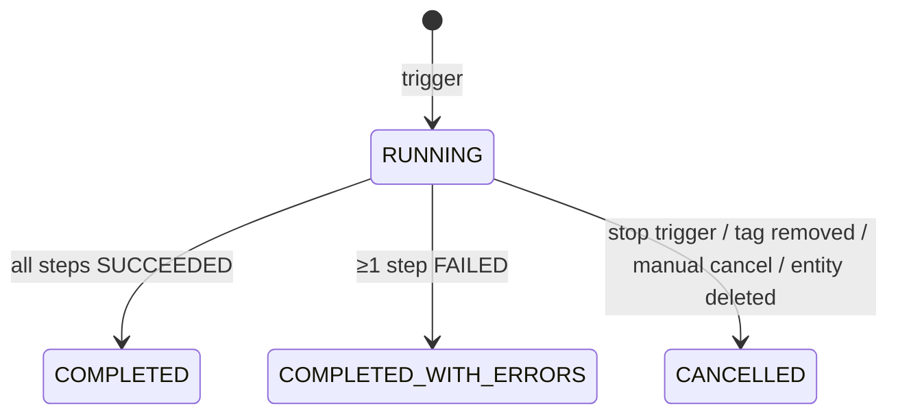

# Automation Specification

## 1. Concepts
- **Procedure:** a named, ordered list of **actions** plus a visual flow graph (stored as JSON for the editor; execution uses only the ordered actions).
- **Trigger binding:** a Tag or Status may name a **start procedure** and/or a **stop procedure** (BR-013, BR-014).
- **Run:** one execution of a procedure for one entity (Contact, Project or Job). The procedure's actions are copied into **run steps** when the run starts, so later edits to the procedure don't affect running runs.

## 2. Lifecycle

Step states: `PENDING → WAITING(dueAt) → SUCCEEDED | FAILED | SKIPPED(run cancelled)`.

**Triggers** (in-process domain events, handled after the triggering transaction commits):

| Event | Effect |
|---|---|
| `TagAdded(entity, tag)` | Cancel the entity's active runs of `tag.stopProcedure`. If `tag.startProcedure` is set and no active run exists for (entity, procedure), create a run. |
| `TagRemoved(entity, tag)` | Cancel the runs started by this tag. |
| `StatusChanged(entity, old, new)` (NF-02) | Treat it as a TagRemoved for `old` and a TagAdded for `new`. |
| `EntityDeleted(entity)` | Cancel all of the entity's active runs. |

Each event carries a `chainDepth`. A change made by an automation step propagates `depth + 1`. At depth > 5 no new runs start, and an audit warning is written.

## 3. Command catalog

Each step returns `SUCCEEDED` with a message, `FAILED` with an error code and message, or `WAIT` with a `dueAt`. Parameters are validated when the procedure is saved (JSON schema per command, published at `GET /automation/commands`). Template placeholders `{{field.path}}` are resolved against a **whitelisted view** of the entity (see §4).

| Command | Applies to | Parameters | Behavior |
|---|---|---|---|
| `DELAY` | all | `{minutes?, hours?, days?, weeks?, months?}` (sum > 0) | Waits for that duration after the previous step finished (BR-104). |
| `WAIT_UNTIL` (timer) | all | `{dateField, offset: {direction: BEFORE\|AFTER, minutes?, hours?, days?, weeks?, months?}}` | Waits until the entity date ± offset. If that moment has already passed, it continues immediately. A missing date → FAILED `DATE_MISSING`. |
| `SEND_EMAIL` | all | `{to: [string], subject, bodyHtml, sendAt?}` | `to` entries are literal emails or placeholders: `{{contact.email}}`, `{{teamMembers.emails}}`, `{{representative.email}}`, `{{projectManager.email}}`. Subject and body are templated; the body HTML is sanitized (allow-list). `sendAt` in the future → WAIT (blocks the following steps). Any invalid recipient → FAILED with the list. Sent through the EmailSender port. |
| `SEND_SMS` | all | `{to: [string], message (≤ 640), sendAt?}` | Same placeholder rules (phone fields). Recipients must be E.164. Sent through the SmsSender port. |
| `ADD_TAGS` / `REMOVE_TAGS` | all | `{tagIds: [uuid]}` (≥ 1) | Adds or removes tags (fires tag events at depth + 1). Unknown tag → FAILED. |
| `SET_STATUS` / `CLEAR_STATUS` | all | `{statusId}` / `{statusId?}` | Sets the status. Clear only if it matches (when given). |
| `ASSIGN_REPRESENTATIVE` | Contact | `{userId}` | FAILED if the contact already has a representative or the user isn't an active member. |
| `CHANGE_CONTACT_TYPE` | Contact | `{type, active?, statusId?}` | Sets the type. `active` is changed only if given. |
| `CREATE_TASK` | Project, Job | `{title, description, startOffsetDays, durationDays, priority?, columnTitle?, assignToManager?: bool, tagIds?}` | Creates a task on the entity's own board (project or job): start = today + offset, end = start + duration. The column is matched by title, falling back to the default. |
| `CREATE_JOB` | Project | `{title, description, startOffsetDays, durationDays, budget, boardTemplateId?}` | Creates a job under the project (BR-060..062). |
| `CREATE_TRANSACTION` | Job | `{type, amount, title, payee, method, dueInDays}` | Creates a transaction for the job and its project (BR-090..092). |
| `SET_MILESTONE` | all | `{milestoneTemplateId}` | Copies the template onto the entity. |
| `CLEAR_MILESTONE` | all | `{}` | Removes the milestone. |
| `COMPLETE_MILESTONE_STEP` | all | `{stepOrder}` | Completes that step (BR-042). FAILED if there is no milestone or no such step. |

The actor recorded for automation changes is the **system user "Automation"** plus the run id (in the audit entry), not a stored user id.

## 4. Template fields (whitelist)
- **Contact:** `name.first`, `name.last`, `fullName`, `company`, `email`, `phone`, `type`, `status.name`, `representative.fullName`, `representative.email`, `address.city`, `metadata.<key>`.
- **Project:** `name`, `type`, `startDate`, `estimatedEndDate`, `budget`, `contact.*`, `projectManager.fullName`, `projectManager.email`, `location.name`, `location.address.city`.
- **Job:** `title`, `startDate`, `estimatedEndDate`, `budget`, `project.*`, `teamManager.*`.

Dates render in the workspace locale (default `en-US`, `MM/dd/yyyy`). A missing value renders as an empty string, and the step result lists `missingFields`.

## 5. Scheduler
- `@Scheduled(fixedDelay = 5s)` + ShedLock `automation-dispatcher` (lock at most 60 s).
- Claim query: `status IN (PENDING, WAITING) AND due_at <= now() AND is the next step of its run`, ordered by `due_at`, `LIMIT 50 FOR UPDATE SKIP LOCKED`.
- Each step runs in its own transaction. External sends (email, SMS) record the provider message id. Retrying a step whose send already succeeded is prevented by an idempotency key `runId:stepId`.
- Transient failures (port timeout) retry 3 times with backoff 1, 5, 15 min, then FAILED.
- Daily purge (03:00 workspace-agnostic UTC): runs finished more than 30 days ago (BR-108).
- Metrics: `automation_steps_executed_total{command, result}`, `automation_queue_due`, `automation_step_latency`.

## 6. Procedure editing rules
- A procedure update replaces its actions. Active runs keep their copied steps.
- A procedure bound as a start or stop procedure can't be deleted (409 `PROCEDURE_IN_USE`) unless `force=true`, which unbinds it and cancels its active runs.
- At least 1 action and at most 50. Each action needs a unique, contiguous `order` starting at 1.
