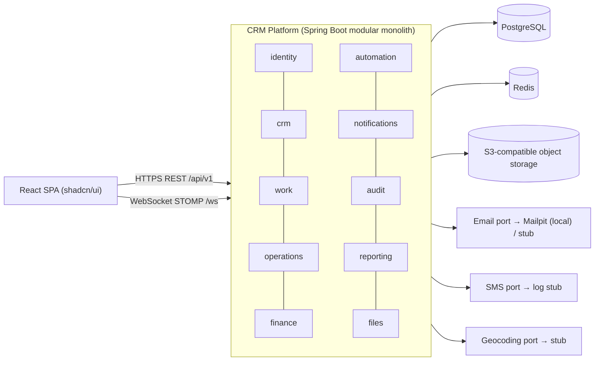

# System Overview — CRM Platform

> Sanitized behavioral specification (clean-room input). It describes **what** the system does, not how any earlier implementation did it.

## 1. Purpose
The CRM Platform is a multi-tenant web application for service and construction businesses. It covers:
- customer relationships: contacts, their sites (locations), categorization, notes;
- delivery work: projects, jobs, tasks on Kanban boards, team members, milestones, flowcharts;
- after-sales: warranties;
- money: transactions and per-entity financial rollups;
- no-code **automation**: procedures triggered by tags or statuses that run timed actions;
- an audit trail, dashboards, and real-time collaboration on boards.

## 2. Users & tenancy
- A **user** signs up with an email and password. Signing up creates a **workspace** (the tenant) and makes the user its **Owner**.
- A user can belong to several workspaces and has one **role** in each: Owner, Admin, Member or Viewer. The token carries the **active workspace**, and the user can switch between workspaces.
- All business data belongs to exactly one workspace and is never visible outside it.
- A **platform super-admin** (a flag on the user, set only via seed or database) can read cross-tenant statistics. It has no other bypass.

## 3. Bounded contexts (modules)

| Module | Responsibility | Key entities |
|---|---|---|
| **identity** | Registration, login, tokens, password reset, workspaces, memberships, invitations, roles and permissions | User, Workspace, Membership, Invitation, RefreshToken |
| **crm** | Contacts and reference data | Contact, Location, Category, Status, Tag, Note |
| **work** | Delivery planning | Project, TeamMember, Milestone (+ templates), Board, Column, Task, BoardTemplate, Flowchart |
| **operations** | Field execution and after-sales | Job, Warranty |
| **finance** | Money ledger and rollups | Transaction, Accounting summary (computed) |
| **automation** | Procedures, triggers, runs, scheduler | Procedure, ProcedureAction, AutomationRun, RunStep |
| **files** | Upload, storage, download links | StoredFile |
| **audit** | Immutable change history | AuditEntry |
| **reporting** | Dashboards and statistics | (read models) |
| **notifications** | In-app notifications | Notification |

Modules talk to each other through public application services and **domain events**. Nothing reaches into another module's tables directly.

## 4. Context diagram

## 5. Key workflows
1. **Onboarding:** sign up → workspace created → the owner invites teammates (email link) → they accept and set a password.
2. **Customer to delivery:** create contact → add a location → create a project at that location (its board is created from a template) → add jobs (each with its own board) → create tasks and move them across columns in real time.
3. **Money:** record received or paid transactions against a job of a project → the rollups for contract, received, actual cost, remaining and P/L update immediately for the job, project and contact.
4. **Automation:** an admin defines a procedure (e.g. *wait 2 days → send email → create task*) and attaches it to a tag or status. When an entity gets that tag or status, a run starts. When the tag is removed or the "stop" tag is added, the run is cancelled.
5. **Oversight:** the audit log of every change, dashboards per workspace, in-app notifications for project membership changes.

## 6. Non-functional goals
| Area | Target |
|---|---|
| Security | OWASP Top-10 mitigations, deny-by-default authorization, strict tenant isolation, no secrets in code |
| Performance | p95 < 300 ms for list and detail endpoints on demo data. Lists are always paginated (≤ 100 items). |
| Reliability | Automation steps run at least once, idempotently, and are safe with several instances |
| Operability | Health and readiness probes, Prometheus metrics, structured JSON logs with correlation ids, tracing |
| Portability | `docker compose up` brings up the full stack locally |
| Accessibility | WCAG 2.1 AA via accessible component primitives |

## 7. Out of scope
Telephony and call logs, chat channels, usage metering and billing, legacy data import, MFA, OAuth social login, email verification (possible future NF items).
